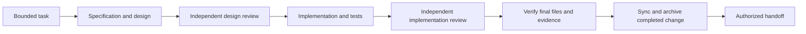

# Spec-driven workflow

A reusable development process built on OpenSpec. It connects a bounded task,
specification, independent review, implementation, verification and handoff.
Apply it to a whole Git repository or to selected parts of an existing one.

For an agent, start with [BOOTSTRAP.md](BOOTSTRAP.md). It explains how to inspect
a target repository, choose its scope and install this workflow without replacing
its existing development rules or settings.

## Install into a project

Run the installer from a checkout of **this workflow repository**. The `--target`
option points to **your existing Git repository**, which will receive the workflow.
Use a reviewed release or commit. Python 3.12+, uv, Node 20.19+ and npm are required.

First, install the workflow's own dependencies in its checkout:

```sh
uv sync --locked
npm --prefix _agentic_harness ci --ignore-scripts
```

Choose one of the following installation options.

### Apply to the whole repository

Choose a short lowercase name for this workflow configuration. The example uses `app`.
It is a label you choose; it does not need to match a repository or folder name.

Replace `/path/to/your-repository` with the path to your Git repository. This
example assumes that its tests run with `npm test`; replace `--check` with your
project's actual validation command, as explained below.

```sh
uv run --locked python tools/workflow.py install \
  --target /path/to/your-repository \
  --project app \
  --spec-root . \
  --scope . \
  --check '["npm", "test"]' \
  --agent codex --agent claude \
  --dry-run
```

Inspect the planned changes, then repeat without `--dry-run` to install.

| Option | Meaning |
| --- | --- |
| `--target /path/to/your-repository` | The Git repository receiving the workflow. |
| `--project app` | Your name for this configuration. Use the same name when selecting it later. |
| `--spec-root .` | Put or reuse `openspec/` at the target repository's root. |
| `--scope .` | Apply the process to the whole target repository. Repeat `--scope` to select several paths instead. |
| `--check '["npm", "test"]'` | Register a validation command to run from the target repository's root during development. |
| `--agent codex --agent claude` | Install integrations for these agents. Include only the ones you use. |
| `--dry-run` | Preview the changes without modifying the target repository. |

The paths in `--spec-root`, `--scope` and `--lockfile` are relative to `--target`.
Here, `.` means the target repository's root, even though the installer runs from
the workflow checkout.

Write each check as a JSON list: the executable followed by its arguments.
For example:

| Your project's command | Installer option |
| --- | --- |
| `npm test` | `--check '["npm", "test"]'` |
| `uv run --locked pytest` | `--check '["uv", "run", "--locked", "pytest"]'` |
| `./gradlew test` | `--check '["./gradlew", "test"]'` |

Repeat `--check` for additional required checks. Installation records these
commands; run them to verify the target project as part of adoption. If the
project has dependency lockfiles, declare their paths with `--lockfile`, for
example `--lockfile package-lock.json`.

### Apply to selected folders

Suppose your repository contains `backend/`, `tests/backend/` and `frontend/`.
To adopt the workflow for the backend and its tests, name the configuration
`backend` and select those two paths:

```sh
uv run --locked python tools/workflow.py install \
  --target /path/to/your-repository \
  --project backend \
  --spec-root backend \
  --scope backend \
  --scope tests/backend \
  --check '["npm", "--prefix", "backend", "test"]' \
  --agent codex --agent claude \
  --dry-run
```

This example puts specifications in `backend/openspec/` and applies the process
to `backend/` and `tests/backend/`. It assumes the backend uses `npm test`; replace
the check if your project uses another command. The source scope excludes
`frontend/`. Installation also adds shared workflow files and scoped agent
instructions at the repository root.

The OpenSpec root and source scope are separate. One project can cover several
source directories. Two independently developed components can have separate
registered projects with non-nested OpenSpec roots. Ambiguous overlapping scopes
are rejected. See
[scope and routing](docs/scope.md).

### Check or update an installation

Run these commands from the workflow checkout:

```sh
uv run --locked python tools/workflow.py doctor --target /path/to/your-repository
uv run --locked python tools/workflow.py update --target /path/to/your-repository --dry-run
```

An update uses the workflow checkout from which the command is run. Review its
version and changes first. Local edits to package-managed files are conflicts;
project configuration and product specifications remain locally owned.

## Use the installed workflow

The installer adds `sdw-run`, `sdw-harden` and `sdw-review` skills for selected
agents, role definitions under the `sdw-` namespace, a scoped instruction block,
and the `_agentic_harness/` runtime. It does not replace global model settings.

From the target repository's Git worktree root, select the name you passed to
`--project`. These commands use `app` from the whole-repository example:

```sh
uv run --locked --project _agentic_harness python \
  _agentic_harness/tools/harness.py project app

uv run --locked --project _agentic_harness python \
  _agentic_harness/tools/harness.py openspec app -- list --json
```

The agent follows the [policy map](_agentic_harness/policies/README.md) and
[execution procedure](_agentic_harness/procedures/execute.md). The runtime is a
set of explicit phase tools, not an unattended task runner. The agent prepares
and verifies the requests, selected project, authorizations and original evidence.
Read-only discovery does not claim work or start the next task.



`budget`, `balanced` and `smart` are explicit profiles in
[plans.yaml](_agentic_harness/plans.yaml). Their model choices and limits are
configuration, not measured claims of equivalent quality or savings. Verify
provider availability before launching a run. Native model calls and GitHub
publication require the applicable task authority.

## OpenSpec ownership

OpenSpec 1.14.3 generates its own `openspec-*` skills and any selected `opsx-*`
commands. This workflow does not modify or shadow those files. Its own policy,
roles and skills have separate ownership. Upstream updates must leave them intact.
Product specs, changes and project context belong to the target project.

The original GitBob importer skills already matched clean OpenSpec output. The
custom root wrappers are replaced by the `sdw-*` entrypoints in this extraction.
See the [extraction inventory](docs/extraction.md) and [provenance](NOTICE.md).

## Develop this package

```sh
uv sync --locked
npm --prefix _agentic_harness ci --ignore-scripts
uv run --locked pytest
```

The tests cover runtime accounting and recovery, project scope, retained source,
installer behavior and real pinned OpenSpec generation. Native-provider and
GitHub transport tests use substitutes; they do not prove live account capability,
model quality or billing. Coordination is local to one clone's shared Git
directory. A scoped instruction or assignment is not an operating-system sandbox.

The verified contracts live under [openspec/specs/](openspec/specs/). The
[archived extraction and verification](openspec/changes/archive/2026-11-10-26-11-10-001-extract-portable-workflow/verification.md)
record the delivered scope and checks. GitBob's migration is a separate follow-up;
this repository does not alter its checkout, active runs or existing evidence.
